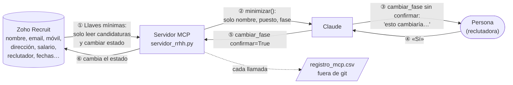

# mcp-rrhh

Servidor MCP que conecta un asistente de IA (Claude) con **Zoho Recruit** para consultar candidatos y cambiar la fase de un candidato en un proceso de selección.

Es un proyecto de aprendizaje sobre dos principios de seguridad:

- **Minimización**: la IA solo ve y solo puede hacer lo imprescindible.
- **Confirmación**: nada cambia en Zoho sin el visto bueno explícito de una persona.

Trabaja con una **cuenta de prueba** de Zoho Recruit y **50 candidatos inventados** (generados con Faker). Nunca con datos reales.

---

## Qué puede hacer

| Herramienta | Qué hace | ¿Cambia datos? |
|---|---|---|
| `listar_candidatos` | Devuelve todos los candidatos con su puesto y su fase | No |
| `buscar_candidatos` | Filtra por puesto y/o fase | No |
| `cambiar_fase` | Cambia la fase de un candidato en una vacante | **Sí, solo con confirmación** |

Fases posibles (las del Hiring Pipeline de Zoho): *En revisión, Entrevista programada, Oferta realizada, Contratado, Rechazado*.

Ejemplos de lo que se le puede pedir a Claude:

- "¿Qué candidatos tengo para Data Engineer y en qué fase están?"
- "Pasa a Sonia Lasa a Entrevista programada" → Claude explica el cambio y pide permiso antes de hacerlo.
- "¿Cuál es el móvil de Feliciana Cantón?" → no lo sabe: el servidor no se lo da.

---

## Recorrido de los datos



- **①** y **②** son **minimización**: primero Zoho limita lo que el servidor *puede tocar*; después el código limita lo que la IA *puede ver*.
- **③**, **④** y **⑤** son **confirmación**: el servidor nunca cambia nada en la primera llamada; solo explica qué haría.
- El **registro** deja constancia de qué se pidió, cuándo y qué se devolvió.

---

## Medidas de seguridad

**Minimización de datos**
- Zoho envía al servidor muchos campos por candidatura (incluidos email y móvil). La función `minimizar` se queda solo con **nombre, puesto y fase**.
- Los archivos con datos de candidatos (`candidatos.json`, `candidatos_zoho.csv`) y el registro viven **fuera del proyecto**, en `~/developer/mcp-rrhh-datos`, para que la IA no pueda leerlos por otra vía y para que nunca lleguen a git.

**Minimización de permisos**
- El servidor usa unas llaves propias que solo pueden **leer candidaturas** y **cambiar el estado de un candidato**. No pueden leer fichas de candidatos, ni vacantes, ni editar ni borrar nada.
- Las llaves con más poder (las de la carga inicial) se crearon para esa tarea y **se anularon al terminar**.
- `comprobar_permisos.py` demuestra qué puede hacer cada llave, sin cambiar nada:

  ```
  Llaves del servidor (ZOHO_REFRESH_TOKEN_SERVIDOR):
    Leer candidaturas................. SÍ
    Leer fichas de candidatos......... NO
    Leer vacantes..................... NO
    Cambiar estado de un candidato.... SÍ
    Editar vacantes................... NO
    Borrar candidatos................. NO
  ```

**Confirmación**
- `cambiar_fase` sin `confirmar=True` solo devuelve "esto cambiaría…". El cambio real exige una segunda llamada tras la aprobación de la persona.
- Si el nombre coincide con varias personas, o la fase no existe, se niega y pide concretar.
- Antes de marcar a alguien como *Contratado*, avisa de que Zoho podría cerrar la vacante y archivar a los demás candidatos.

**Secretos**
- Las llaves están en `.env`, que está en `.gitignore` y nunca se sube a GitHub.
- `obtener_token.py` pide el código de Zoho sin mostrarlo en pantalla y nunca imprime el token.

**Trazabilidad**
- Cada llamada queda anotada en `~/developer/mcp-rrhh-datos/registro_mcp.csv` (fecha, herramienta, qué se pidió, qué se devolvió). Contiene nombres, así que también vive fuera de git.

Las decisiones detrás de cada medida, y los errores que llevaron a ellas, están en [DECISIONES.md](DECISIONES.md).

---

## Archivos

| Archivo | Para qué sirve |
|---|---|
| `servidor_rrhh.py` | El servidor MCP |
| `.mcp.json` | Le dice a Claude Code cómo arrancar el servidor en esta carpeta |
| `.env` | Llaves de Zoho (no está en git) |
| `obtener_token.py` | Cambia el código temporal de Zoho por unas llaves y las guarda en `.env` |
| `comprobar_permisos.py` | Muestra qué puede hacer cada juego de llaves, sin cambiar nada |
| `generar_candidatos.py` | Crea los 50 candidatos falsos con Faker (carga inicial) |
| `cargar_en_zoho.py` | Asocia cada candidato a su vacante con su fase (carga inicial) |
| `actualizar_datos_zoho.py` | Añade móvil, dirección y salario falsos en Zoho (para probar la minimización) |

Los tres últimos solo se usaron para preparar la cuenta de prueba. Necesitan llaves de carga, que ya están anuladas: habría que generar otras con `obtener_token.py` y anularlas al terminar.

---

## Instalación

Necesita Python 3.12 y una cuenta de Zoho Recruit (esta usa el centro de datos europeo, `zoho.eu`).

1. Crear el entorno e instalar las librerías:

   ```bash
   cd ~/developer/GitHub/mcp-rrhh
   uv venv && source .venv/bin/activate
   uv pip install fastmcp httpx python-dotenv faker
   ```

2. Crear las llaves en **https://api-console.zoho.eu** → *Self Client*. Copiar *Client ID* y *Client Secret* en `.env`:

   ```
   ZOHO_CLIENT_ID=...
   ZOHO_CLIENT_SECRET=...
   ```

3. En *Generate Code*, generar un código con estos permisos (10 minutos):

   ```
   ZohoRecruit.modules.application.READ,ZohoRecruit.modules.candidate.UPDATE
   ```

   y ejecutar:

   ```bash
   python obtener_token.py ZOHO_REFRESH_TOKEN_SERVIDOR
   ```

4. Comprobar los permisos:

   ```bash
   python comprobar_permisos.py
   ```

### Conectarlo a Claude

- **Claude Code**: abrir una sesión en esta carpeta. `.mcp.json` ya lo configura; Claude pedirá permiso para activar el servidor `rrhh`.
- **Chat de la app de escritorio**: añadir a `~/Library/Application Support/Claude/claude_desktop_config.json` y reiniciar la app:

  ```json
  "mcpServers": {
    "rrhh": {
      "command": "/Users/dulcecova/developer/GitHub/mcp-rrhh/.venv/bin/python",
      "args": ["/Users/dulcecova/developer/GitHub/mcp-rrhh/servidor_rrhh.py"]
    }
  }
  ```

Para comprobar que la minimización funciona, mejor usar el **Chat**: ahí Claude solo tiene las herramientas del servidor. En Claude Code también puede leer archivos de la carpeta.
